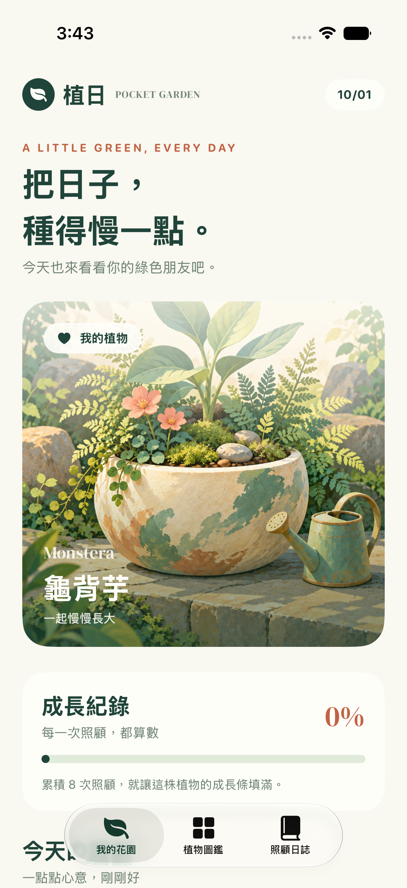
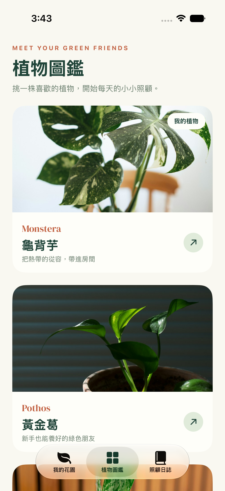
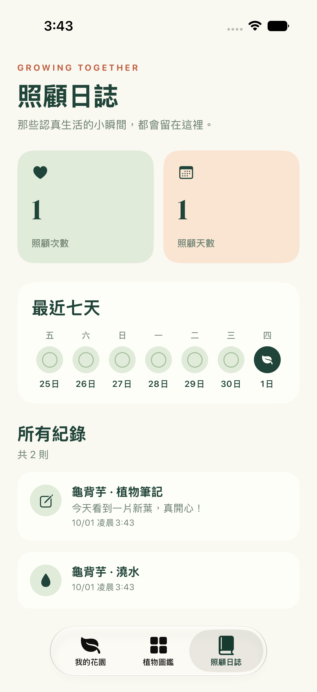

# 植日 PocketGarden

一款用 SwiftUI 製作的植物照顧工具 App。認識室內植物、選擇自己的植物，每天記錄澆水、曬太陽與照顧筆記。資料儲存在裝置上，重新開啟 App 後仍會保留。

<p align="center">
  
  
  
</p>

## 功能

- **我的花園**：顯示目前植物、成長進度與照顧提醒；每天可各記錄一次澆水和曬太陽，也能寫筆記。
- **植物圖鑑**：瀏覽龜背芋、黃金葛、虎尾蘭的網路照片與照顧資訊，並選為自己的植物。
- **照顧日誌**：查看照顧次數、照顧天數、最近七天的狀態與歷史紀錄。

[觀看操作影片](Deliverables/final-demo.mp4) · [查看植物介紹頁](Deliverables/versions/final-detail.png)

## 執行方式

1. Clone 本倉庫，使用 Xcode 開啟 `PocketGarden.xcodeproj`。
2. 選擇 `PocketGarden` scheme 與 iPhone 模擬器，按 **⌘R**。

本專案使用 Xcode Beta 27 建置，部署目標為 iOS 17。若終端機的預設開發者目錄不是 Xcode，可執行：

```sh
export DEVELOPER_DIR=/Applications/Xcode-beta.app/Contents/Developer
xcodebuild -project PocketGarden.xcodeproj \
  -scheme PocketGarden \
  -destination 'platform=iOS Simulator,name=iPhone 17 Pro,OS=27.0' \
  CODE_SIGNING_ALLOWED=NO build
```

`project.yml` 是 XcodeGen 專案設定；倉庫已附上 `.xcodeproj`，一般執行不需要安裝 XcodeGen。植物照片由 `AsyncImage` 從網路載入；離線時會顯示替代圖示。

## 作業對照

依照 [#242 使用 AI 創作人生第一個 App](https://medium.com/彼得潘的試煉-勇者的-100-道-swift-ios-app-謎題/242-使用-ai-copilot-edit-創作人生第一個-app-934495e1a28d) 完成：

| 要求 | 成果 |
| --- | --- |
| 小遊戲或工具 App、多個頁面 | 植物照顧工具；花園、圖鑑、日誌與植物詳情頁 |
| 使用 AI 輔助開發 | Codex 協助開發，Xcode Beta 建置；附[對話摘錄](Deliverables/AI_CONVERSATION.md) |
| App 名稱與 Icon | 名稱「植日」；[原創 App Icon](PocketGarden/Assets.xcassets/AppIcon.appiconset/AppIcon.png) |
| 本機圖片與網路圖片 | [原創首頁插畫](PocketGarden/Assets.xcassets/GardenHero.imageset/GardenHero.png)與圖鑑的 Unsplash 照片 |
| 客製字體 | 隨 App 附上 DM Serif Display，並在 `UIAppFonts` 註冊 |
| 版本截圖 | [v1](Deliverables/versions/v1-home.png)、[v2](Deliverables/versions/v2-home.png)與最終版各頁截圖 |
| 最終版操作影片 | [final-demo.mp4](Deliverables/final-demo.mp4) |

字體授權、照片作者與來源列於[素材來源](PocketGarden/Resources/ASSET_CREDITS.md)。

## 驗證

已在 Xcode Beta 27 的 iPhone 17 Pro（iOS 27）模擬器建置成功；1 項 UI 流程測試通過，涵蓋照顧、筆記、圖鑑、選植物及重新啟動後的資料保存。
